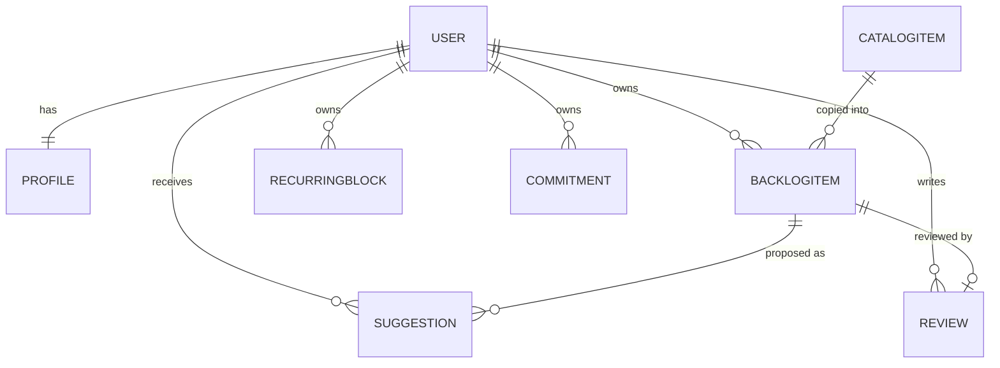
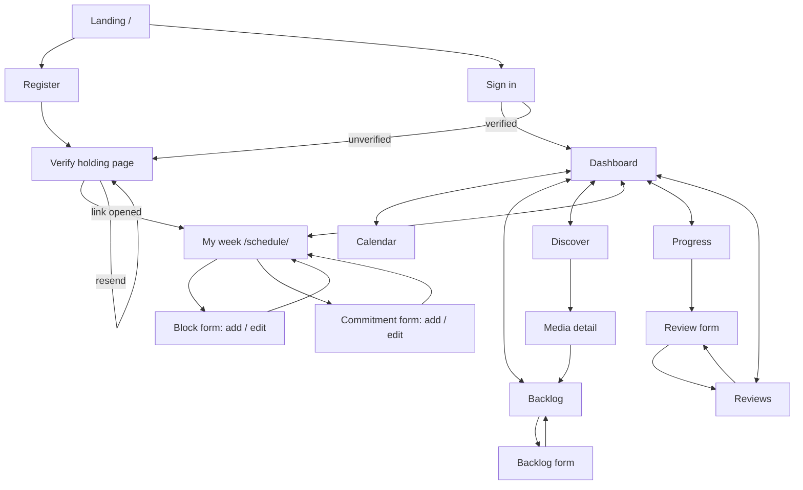
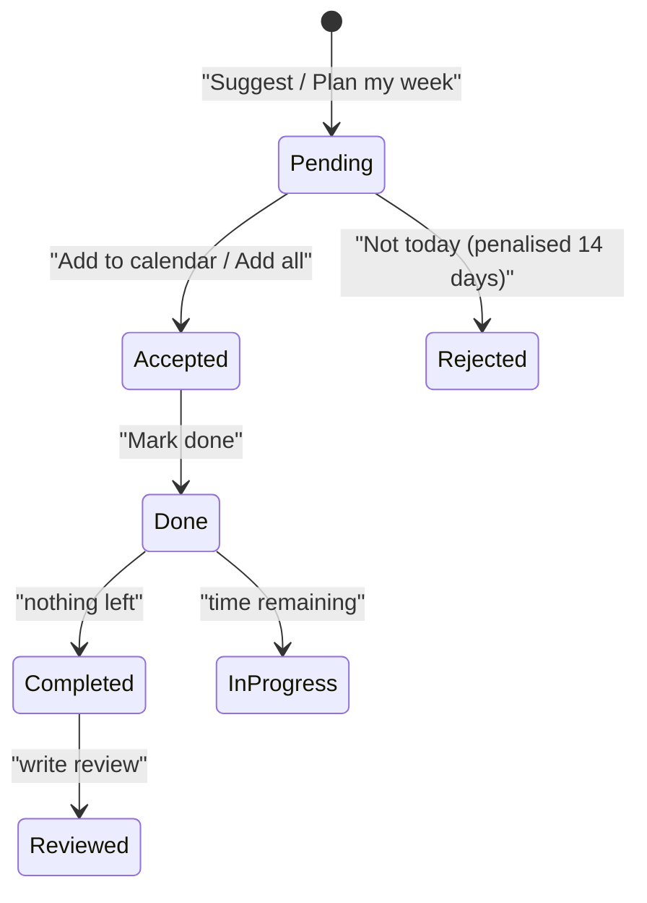

## 4. Specification & Design (Jesse)

MediaFlow is a server-rendered Django application. Views (`planner/views.py`) handle HTTP only; all scheduling logic lives in `planner/services.py` so it can be tested without going through a browser. Actors are a **visitor** (not signed in), a **student** (signed in with a verified `@mavs.uta.edu` address), an **admin** (maintains the catalog), and the **server clock**, because free time is always measured against the current time.

### 4.1 What changed since Iteration 1

| Area | Iteration 2 specification |
| --- | --- |
| Scheduling | Recurring blocks and commitments can now be **edited and deleted** (`/schedule/block/<id>/edit|delete/`, `/schedule/commitment/<id>/edit|delete/`). |
| Weekly planning | **Plan my week** (`POST /suggestions/plan-week/`) fills free time across seven days. **Add all to calendar** (`POST /suggestions/accept-week/`) accepts every pending suggestion in the window. |
| Account security | Registration sends a **signed, expiring verification email**. Unverified users see only a holding page and can sign out or resend the email. |
| Engagement | **Progress page** (`/progress/`): 30-day chart, current/best streak, time per media type, finished counts, average rating. |
| Reminders | Opt-in reminders before accepted sessions and commitments (`/notifications/upcoming/`, lead time 1–120 min). |
| Recommendations | Scoring weights are now a named, validated structure (`ScoringWeights`) and a **variety penalty** keeps a week from repeating one title. |
| Usability | Priority labels (1 Someday … 5 Must play next), per-day schedule entry, **"Not today"** beside "Add to calendar", paged Discover, mobile layout, friendly 404/500 pages. |

### 4.2 Inputs

Every signed-in request also carries a session cookie, a CSRF token on POSTs and the current time.

| Screen / route | Field | Rules |
| --- | --- | --- |
| Register `POST /register/` | `username`, `email`, `password1/2` | Email must end in `@mavs.uta.edu` and be unused; passwords match and pass Django validators |
| Verify `GET /verify/<token>/` | signed token | Must be genuine, unexpired (3 days), issued for this account and this email |
| Resend `POST /verify/resend/` | none | Login required; 60-second cooldown |
| Waking hours `POST /schedule/` | `day_start`, `day_end` | End after start |
| Recurring block (add/edit) | `label` ≤120, `kind`, `weekday` 0–6, `start_time`, `end_time` | End after start |
| Commitment (add/edit) | `title` ≤200, `starts_at`, `ends_at` | End after start |
| Reminder settings | `notify_enabled`, `notify_lead_minutes` | Lead time 1–120 |
| Backlog item | `title`, `media_type`, `priority` 1–5, `estimated_minutes`, `minutes_completed`, `status`, `notes` | Completed ≤ estimate; unique per (user, catalog item) |
| Suggest / Plan week | optional `date` | Unparseable falls back to today |
| Respond `POST /suggestions/<id>/<action>/` | action = accept, reject, done | Anything else is a 404 |
| Review `POST /reviews/<id>/write/` | `rating` 1–5, `body` | Rating required |
| Discover `GET /discover/` | `q`, `media_type`, `genre`, `max_minutes`, `sort`, `page` | Bad values fall back to defaults |

### 4.3 Outputs

HTML pages (every GET); redirects after every successful write (so a refresh never repeats it); flash messages; field-level errors with the user's input kept; free intervals; up to three suggestions per day, each with a written reason ("You have 3h free and its 2h 35m runtime fits in one sitting"); progress statistics; reminder JSON; 404 for another user's data; 302 to sign-in when signed out; 405 for a GET on a POST-only action.

### 4.4 Data structures

| Model | Key fields | Iteration 2 notes |
| --- | --- | --- |
| `Profile` | `day_start`, `day_end`, `email_verified`, `verification_sent_at`, `notify_enabled`, `notify_lead_minutes` | Verification and reminder fields added (migrations 0002, 0003) |
| `CatalogItem` | title, slug, media_type, genre, creator, rating, `typical_minutes`, source id | Source field added so catalog imports can refresh rows (migration 0004) |
| `BacklogItem` | priority 1–5, estimated/completed minutes, status, `completed_at` | Priority labels come from `PRIORITY_LABELS` |
| `RecurringBlock`, `Commitment` | weekly or dated busy time | Now editable and deletable |
| `Suggestion` | item, date, start/end, minutes, reason, status, `responded_at` | `responded_at` feeds Progress |
| `Review` | one-to-one with a backlog item, rating, body | |

Runtime structures: `Interval` and `BusyBlock` (frozen dataclasses, so recurring blocks, commitments and accepted sessions all flow through one code path), `SESSION_RULES` (a lookup table that makes a film behave differently from a book), `day_plan()`, `month_grid()`, `progress_stats()`, and the immutable `ScoringWeights`.

**Design decisions**

- *Store busy time, derive free time.* Students know their class times, not their gaps, and derived time is never stale.
- *Rejections are rows, not flags,* so the "Not today" penalty fades after 14 days instead of hiding a title forever.
- *Verification token holds no database row.* It is a signed `{user id, email}` pair with a salt and expiry, so it stops working if the email changes or the account is deleted.
- *Weights are one frozen dataclass.* Each number is documented in steps of one priority level, and tests pin those relationships.

### 4.5 Algorithms

**Free time.** A cursor starts at `day_start` (or now, if the day is today) and walks the busy blocks in order: blocks ending before the cursor are skipped, blocks starting after it leave a gap, and the cursor jumps to each block's end, so overlaps resolve themselves. Gaps under 20 minutes are dropped.

**Scoring** (highest wins a gap): `priority × 20`, `+25` if already started, `+ (minutes ÷ gap) × 30`, `+15` for a film that fits, `+20` if the sitting finishes the item, `−35` per "Not today" in the last 14 days, `−15` per earlier sitting of the same item that week.

**Plan my week.** `suggest_for_week()` runs `suggest_for_day()` for seven consecutive days, telling each day what earlier days already took. Result: a film is planned once, a book is never planned past its last page, and later days favour variety. Existing pending suggestions in the window are cleared first; accepted and rejected ones are kept.

### 4.6 Use cases

| Use case | Main flow | Exceptions |
| --- | --- | --- |
| **UC-1 Register & verify** | Submit username, UTA email, password. Account created, verification email sent, holding page shown. Opening the link unlocks the app. | Non-UTA or duplicate email; weak password; forged, expired or stale link; mail server failure (account is kept, user told); resend inside the cooldown |
| **UC-2 Sign in / out** | Credentials, then dashboard. Unverified users land on the holding page. | Wrong credentials; protected page forwards back after sign-in |
| **UC-3 Manage schedule** | Add, **edit** or **delete** recurring blocks and commitments; free time recalculates. | End not after start; another user's row is a 404; delete requires POST |
| **UC-4 Waking hours / reminders** | Set wake and bedtime; opt in to reminders and choose lead time. | Bedtime not after wake-up; lead time outside 1–120 |
| **UC-5 Search & details** | Filter by text, type, genre, length; page through results; see whether an item fits today. | No matches; bad page number falls back |
| **UC-6 Maintain backlog** | Add from catalog or by hand, change priority inline, edit, filter, remove. | Duplicate add; completed > estimate; priority clamped to 1–5 |
| **UC-7 Daily suggestion** | "Suggest something" returns up to 3 items for the biggest gaps. | Empty backlog; no free time; nothing fits (three separate messages) |
| **UC-8 Plan my week** | One click generates suggestions for seven days; **Add all** accepts the pending ones. | Same three empty cases; nothing pending to accept |
| **UC-9 Accept / Not today / Done** | Accept moves time out of "free"; Not today penalises the item; Done logs minutes and may complete the item. | Double accept is harmless; progress capped at the estimate; completing prompts a review |
| **UC-10 Calendar** | Month grid; click a day for busy blocks, sessions and gaps. | Bad date falls back to today; more than two sessions shows "+N more" |
| **UC-11 Progress** | Chart, streaks, time by type, recently finished. | New user sees empty states, not errors |
| **UC-12 Review** | Rate 1–5 with optional text; reviewing an item marks it complete. | Rating out of range; reopening edits the existing review |

### 4.7 Screen transitions

### 4.8 Consistency rules

1. Successful writes redirect, never render, so a refresh cannot repeat them.
2. Failed validation re-renders the same form, so exception edges are self-loops.
3. A `next` field decides where an action returns (dashboard, calendar or schedule).
4. Every row is fetched filtered by `user`, so another user's data is always a 404.
5. Unverified users are held at the verification page by middleware, except for sign-out, resend and the reminder poll.

### 4.9 Known gaps (planned for Iteration 3)

First-use walkthrough, overnight schedules (bedtime after midnight is currently rejected), forgot-password, a richer review system, and a single priority format everywhere.

---

## 6. Testing (Jesse)

### 6.1 Strategy

Testing is automated and runs on every push and pull request through GitHub Actions (`.github/workflows/checks.yml`). We favour fast unit tests on the service layer (pure scheduling logic with no HTTP), backed by Django test-client tests that cover views, redirects, permissions and form errors. External services are replaced with fakes (a fake HTTP fetcher for catalog imports, Django's in-memory mail outbox for email), so the suite needs no network or credentials.

**Result at Iteration 2: 341 tests, 0 failures** (`python manage.py test`, about 110 seconds).

### 6.2 What the pipeline checks

| Check | Purpose |
| --- | --- |
| `makemigrations --check` | Fails if a model changed without a migration |
| `manage.py test` | Full 341-test suite |
| `check --deploy --fail-level WARNING` | Django's security checks against production-style settings |
| Built CSS up to date | Fails if a template uses a Tailwind class and nobody rebuilt `app.css` |
| Docker build and `/healthz/` | Confirms the container builds, starts and reports healthy |

### 6.3 Coverage by feature

| Feature (use case) | Test classes | What is verified |
| --- | --- | --- |
| Free time (UC-3, UC-4) | `FreeTimeTests` | Empty day, block splits a day, overlapping blocks merge, dated commitments, gaps under 20 min dropped, waking hours bound the search |
| Suggestions (UC-7) | `SuggestionTests`, `HelperTests` | Film needs whole runtime, book fits where film does not, no item eats a whole day, nearly-done item runs to end, priority breaks ties, rejection demotes, completed items skipped, accepted time no longer free, no duplicates across gaps |
| Scoring (UC-7, UC-8) | `ScoringWeightsTests`, `ScoringWeightsValidationTests`, `ScoringTradeoffTests`, `RealisticDaysTests`, `ScoringOverrideTests` | Each term in isolation; negative weights refused; trade-offs pinned (for example one "Not today" drops a 4 below a fresh 3 but not a fresh 2); realistic Tuesday and Saturday schedules |
| Plan my week (UC-8) | `WeekPlanTests`, `WeekViewTests` | Seven consecutive days; a film planned once; never plans more than what is left; variety on later days; `persist=False` writes nothing; replaces old pending but keeps accepted and rejected; other users untouched; POST-only and login required; Add all accepts only this user's pending, in this week |
| Schedule edit/delete (UC-3) | `ScheduleEditTests` | Prefilled forms, saving moves free time, end-before-start rejected, delete needs POST, cannot touch another user's schedule, login required |
| Email verification (UC-1) | `VerificationTests`, `NavVisibilityTests` | One email with a link on registration; unverified users blocked but can sign out; link unlocks account (also in another browser); reuse is harmless; forged, wrong-salt, expired, changed-email and deleted-account tokens rejected; link only verifies its own account; resend cooldown and rate limit; mail failure keeps the account; staff and demo accounts exempt; UTA rule still applies |
| Reminders (UC-4) | `ReminderTests`, `ReminderViewTests` | Window edges, crossing midnight, only accepted sessions, sorted soonest first, per-user isolation, opt-in required, invalid lead time rejected |
| Progress (UC-11) | `ProgressStatsTests`, `ProgressViewTests`, `AxisTests` | Zeros for a new user, 30-day window, local-time day boundaries, only sessions marked done count, streak and best streak, gap ends a streak, per-type shares, chart scaling, average rating, other users excluded, login and verification enforced |
| Search & catalog (UC-5) | `PageTests`, `DiscoverPagingTests` | Filters, 24 per page, no overlap or skipped rows, filters kept in page links, bad page falls back |
| Catalog import | `*SourceTests`, `SaveRecordTests`, `ImportCommandTests`, resume tests | Book, movie, TV and game sources; rate limiting and retries; duplicates; dry run; resumable imports |
| Accounts and deployment | `RegisterTests`, `ResetAccountsTests`, `EnvFileTests`, `SettingsTests`, `DeployCheckTests`, `HealthCheckTests`, `ErrorPageTests`, `ContainerFilesTests` | Settings refuse to start on a weak or missing secret key; error pages leak no details; container runs as non-root and keeps secrets out of the image |
| Security (all) | `test_cannot_touch_another_users_*`, login-required tests | Cross-user access is always a 404; protected routes redirect when signed out |

### 6.4 Sample test cases

| ID | Scenario | Input | Expected result |
| --- | --- | --- | --- |
| T-01 | Overlapping busy blocks | Two blocks that overlap on one day | One merged busy period; free time computed correctly |
| T-02 | Film does not fit | 2h30 film, 1h gap | Film not suggested; a book chunk is |
| T-03 | Not today | Reject an item | Item loses 35 points for 14 days, then returns |
| T-04 | Plan my week | Backlog with one film, seven free days | Film appears exactly once in the week |
| T-05 | Expired link | Token older than 3 days | Rejected; account stays unverified |
| T-06 | Changed email | Token issued, then email edited | Link rejected |
| T-07 | Resend spam | Two resends within 60 s | Second refused with the wait shown |
| T-08 | Edit block, end before start | End 9:00, start 10:00 | Form redisplayed with error; nothing saved |
| T-09 | Cross-user access | User A requests user B's block | 404 |
| T-10 | Streak | Sessions done today and yesterday, none the day before | Current streak 2 |

### 6.5 Manual and user testing

Beyond the automated suite, the team ran user tests with classmates after Iteration 1. Feedback that changed this iteration: an unclear priority scale (now labelled), one-at-a-time schedule entry (now per day), and no way to dismiss a suggestion (now "Not today"). Iteration 3 repeats this with the same testers as a cold-start run: sign up, verify, set up a week, accept a suggestion, mark it done.

### 6.6 Known limitations

- There are no browser-level (end-to-end) tests; page behaviour is checked through the Django test client and rendered HTML.
- Email delivery to real `@mavs.uta.edu` inboxes (spam filtering) cannot be proven by unit tests and needs manual testing; this is the verification-email risk in the project plan.
- Overnight schedules, forgot-password and the walkthrough have no tests yet because they are not built.
