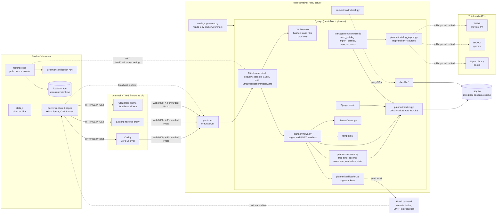
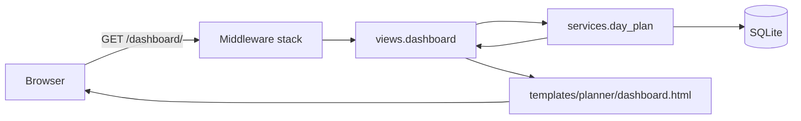
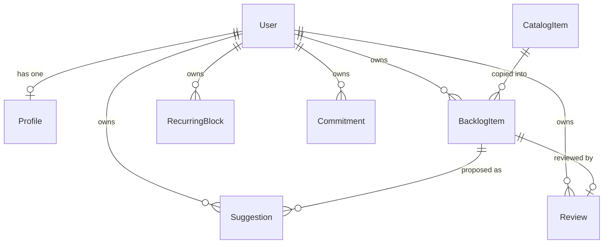
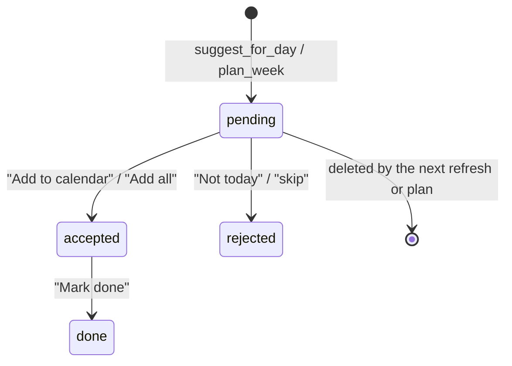
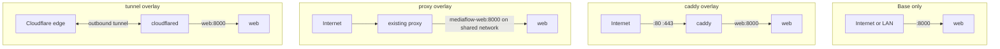

# MediaFlow: technical documentation

CSE 3311, Team 2. Written against the code as of commit `073b88b` (October 2026).

This document explains how the system is built and how it behaves, down to the
level of individual functions, fields, and configuration variables. It is meant
for a developer joining the project, or a grader who wants to see how the
pieces fit. The `README.md` covers day-to-day commands; the two files under
`docs/` named `specification-and-design` are the course deliverables. This
document goes deeper than either and is organised by subsystem rather than by
iteration.

## Contents

1. [What the system does](#1-what-the-system-does)
2. [Technology stack](#2-technology-stack)
3. [Repository layout](#3-repository-layout)
4. [Architecture and request flow](#4-architecture-and-request-flow)
5. [Configuration and settings](#5-configuration-and-settings)
6. [Data model](#6-data-model)
7. [Accounts and email verification](#7-accounts-and-email-verification)
8. [URL routes and views](#8-url-routes-and-views)
9. [Scheduling engine](#9-scheduling-engine)
10. [Suggestion lifecycle](#10-suggestion-lifecycle)
11. [Reminders](#11-reminders)
12. [Progress statistics](#12-progress-statistics)
13. [Calendar](#13-calendar)
14. [Catalog: seed data and imports](#14-catalog-seed-data-and-imports)
15. [Management commands](#15-management-commands)
16. [Front end: templates, CSS, JavaScript](#16-front-end-templates-css-javascript)
17. [Admin](#17-admin)
18. [Production hardening](#18-production-hardening)
19. [Docker and deployment topologies](#19-docker-and-deployment-topologies)
20. [Testing and continuous integration](#20-testing-and-continuous-integration)
21. [Known limitations and future work](#21-known-limitations-and-future-work)
22. [Glossary](#22-glossary)

---

## 1. What the system does

MediaFlow is a web application for University of Texas at Arlington students.
A student keeps films, TV series, books and games in a single backlog, tells
the app when they are busy each week, and the app works out when they are
free and proposes something from the backlog that fits each free gap.

The core loop is:

1. The student enters recurring busy blocks (classes, shifts) and one-off
   commitments.
2. The app subtracts those from the student's waking hours to find free gaps.
3. For each gap it scores every unfinished backlog item and proposes the
   best fit. A film is proposed only if its whole runtime fits. A book, show
   or game is proposed as a chunk (a chapter, an episode, a session) capped
   at one sitting.
4. The student accepts, rejects, or later marks a proposal done. Accepting
   puts it on the calendar and blocks that time. Rejecting penalises the item
   for two weeks. Marking it done logs the planned minutes against the item.
5. The Progress page summarises time logged, streaks and finished items.

Everything is server-rendered Django. There is no JavaScript framework and no
API beyond one JSON endpoint used for reminder polling.

---

## 2. Technology stack

| Layer | Choice | Notes |
| --- | --- | --- |
| Language | Python 3.12 | The Docker image uses `python:3.12-slim`; CI uses 3.12. |
| Web framework | Django 5.2 (`>=5.2,<6.0`) | Server-rendered templates, built-in auth, ORM, admin. |
| Database | SQLite | One file, `db.sqlite3` by default, path set by `DATABASE_PATH`. No other database backend is configured. |
| Static files in production | WhiteNoise 6.x | Only active when `DEBUG` is off. Serves hashed, compressed files. |
| Production WSGI server | Gunicorn 22+ | Installed only on non-Windows platforms (`sys_platform != "win32"` marker in `requirements.txt`). |
| CSS | Tailwind CSS 4 via `@tailwindcss/cli` | Built file is committed. Node is needed only to change styles. |
| JavaScript | Two small vanilla scripts | `static/js/reminders.js` and `static/js/stats.js`. No bundler. |
| Containers | Docker, Docker Compose | One `web` service plus optional overlay files for Caddy, an existing proxy, or a Cloudflare Tunnel. |
| HTTPS | Caddy 2 (bundled) or an external proxy or Cloudflare | Chosen by which compose overlay is used. |
| External data | Open Library, TMDB, RAWG | Read through `urllib` in `planner/catalog_import.py`. No third-party HTTP library. |
| CI | GitHub Actions | `.github/workflows/checks.yml`, three jobs. |

The only non-standard-library Python packages are Django, WhiteNoise and
Gunicorn. The `.env` file reader, the HTTP client, and the test fakes are all
written in the project.

---

## 3. Repository layout

```
CSE3311_Team2/
├── manage.py                      Django entry point
├── requirements.txt               Python dependencies
├── package.json                   Tailwind build scripts
├── .env.example                   Every supported variable, with placeholders
├── .env                           Local secrets (git-ignored)
├── db.sqlite3                     Local database (git-ignored)
│
├── mediaflow/                     The Django project (settings, root URLs)
│   ├── settings.py                All configuration; reads the environment
│   ├── env.py                     .env parser and typed env helpers
│   ├── urls.py                    Mounts admin, auth, and the planner app
│   ├── apps.py                    Staticfiles config that skips static/src
│   ├── wsgi.py / asgi.py          Server entry points
│
├── planner/                       The one Django app
│   ├── models.py                  Profile, CatalogItem, BacklogItem, RecurringBlock,
│   │                              Commitment, Suggestion, Review, SESSION_RULES
│   ├── services.py                Free time, scoring, week planning, reminders,
│   │                              progress stats, month grid
│   ├── views.py                   Every page and POST handler
│   ├── urls.py                    App routes
│   ├── forms.py                   ModelForms and the Discover filter form
│   ├── verification.py            Signed email-confirmation tokens
│   ├── middleware.py              Holds unverified users on the "check your email" page
│   ├── checks.py                  Extra `manage.py check --deploy` warning
│   ├── admin.py                   Admin registrations
│   ├── catalog_import.py          Open Library / TMDB / RAWG importers
│   ├── tests.py                   341 tests, one file
│   ├── migrations/                0001 through 0004
│   └── management/commands/
│       ├── seed_catalog.py        36 hand-entered titles, optional demo account
│       ├── import_catalog.py      Pulls real titles from the three sources
│       └── reset_accounts.py      Deletes student accounts (DEBUG only)
│
├── templates/
│   ├── base.html                  Nav, flash messages, footer, reminders script
│   ├── 404.html / 500.html
│   ├── planner/                   One template per page, plus _suggestion.html
│   └── registration/              login, register, verify_* pages, email body
│
├── static/
│   ├── src/app.css                Tailwind source (edit this)
│   ├── css/app.css                Built, minified output (committed, do not edit)
│   └── js/reminders.js, stats.js
│
├── Dockerfile
├── docker-compose.yml             Base: the web service
├── docker-compose.caddy.yml       Overlay: bundled Caddy for HTTPS
├── docker-compose.proxy.yml       Overlay: join an existing proxy's network
├── docker-compose.tunnel.yml      Overlay: Cloudflare Tunnel sidecar
├── Caddyfile
├── docker/healthcheck.py          Container health probe
├── .dockerignore, .gitattributes
│
├── .github/workflows/checks.yml   CI
└── docs/                          Course deliverables and this file
```

---

## 4. Architecture and request flow

### 4.1 The moving parts

The diagram shows every runtime component, which process it lives in, and
what talks to what. Solid arrows are synchronous calls on a request; dashed
arrows are things that happen on a timer or on demand from the command line.



Reading it from left to right:

- **The browser** only ever submits HTML forms and follows redirects. The
  two scripts are additive: the pages work without them. The reminders
  script is the single place the browser makes a background request.
- **The HTTPS front** is optional and comes from one of three compose
  overlays (section 19). On a laptop nothing sits in front and the browser
  talks to `runserver` on port 8000 directly.
- **Inside the container** gunicorn hands each request to Django. The
  middleware stack runs first; when `DEBUG` is off WhiteNoise answers
  requests for `/static/` before any view runs. Views are thin and delegate
  to services, forms and the verification helpers, then render a template.
  Everything the scheduler knows comes from the ORM models, and
  `SESSION_RULES` lives beside them.
- **The database** is one SQLite file. In Docker it is on the
  `mediaflow-data` volume; locally it is `db.sqlite3` in the repository.
- **Email** is the only outbound side effect of a request. In development
  the console backend prints the message in the server's terminal.
- **The third-party APIs** are never called during a request. Only the
  `import_catalog` command reaches them, through the project's own
  `HttpFetcher`, and the results land in the same catalog table the pages
  read.
- **The health probe** runs inside the container on Docker's timer and asks
  the app's own `/healthz/`, which in turn pings the database.
- **Configuration** is read once at startup from the environment, with
  `.env` as a fallback, and shapes which middleware, storage and security
  settings are active.

### 4.2 Layers

MediaFlow is a monolith with three layers inside the `planner` app:

- **Views** (`planner/views.py`) handle HTTP: parse the request, call a
  service, build a context, render a template or redirect. They contain
  almost no business logic.
- **Services** (`planner/services.py`) hold the algorithms: free-time
  detection, scoring, week planning, reminder windows, progress aggregation,
  calendar grid. They take a `user` and plain Python values and return plain
  Python values or unsaved model instances. They are tested directly, without
  HTTP.
- **Models** (`planner/models.py`) define the schema plus the per-type
  `SESSION_RULES` table and the `session_minutes_for` method that turns a gap
  size into a sitting length.

A typical page request moves through this middleware stack, in order:

1. `SecurityMiddleware` (and `WhiteNoiseMiddleware` right after it when
   `DEBUG` is off)
2. `SessionMiddleware`
3. `CommonMiddleware`
4. `CsrfViewMiddleware`
5. `AuthenticationMiddleware`
6. `MessageMiddleware`
7. `XFrameOptionsMiddleware`
8. `planner.middleware.EmailVerificationMiddleware`

The last one is project code. It runs in `process_view`, after URL
resolution, and redirects any signed-in, unverified, non-staff user to the
holding page unless the URL is one of a short allow-list (section 7).



All state-changing actions are `POST` forms protected by Django's CSRF token.
Most handlers are decorated with `@login_required` and `@require_POST`. Many
forms carry a hidden `next` field so the handler can redirect back to the
page the user was on.

Time zone: `TIME_ZONE = "America/Chicago"` with `USE_TZ = True`. Datetimes
are stored in UTC and converted with `timezone.localtime` wherever a date is
derived from one. `timezone.localdate()` is "today" throughout the code.

---

## 5. Configuration and settings

### 5.1 How settings are read

`mediaflow/settings.py` reads every configurable value from the process
environment. Before it looks at `os.environ`, it calls
`load_env_file(...)` from `mediaflow/env.py` on the file named by
`DJANGO_ENV_FILE`, defaulting to `.env` next to `manage.py`. The loader uses
`os.environ.setdefault`, so a real environment variable always wins over the
file.

The `.env` parser (`parse_env_file`) handles:

- `NAME=value` lines; blank lines and lines starting with `#` are skipped.
- An optional `export ` prefix.
- Values wrapped in matching single or double quotes, taken literally (so `#`
  and `=` inside survive).
- Unquoted values with a trailing comment: a `#` preceded by a space or tab
  ends the value.
- A UTF-8 byte order mark and Windows line endings (`utf-8-sig`,
  `splitlines`).
- A missing file, which yields an empty dict.

Typed helpers in the same module:

| Helper | Behaviour |
| --- | --- |
| `env_bool(name, default)` | Accepts `1/true/yes/on` and `0/false/no/off`, case-insensitive. Unset or empty returns the default. Anything else raises `ValueError`, so `DJANGO_DEBUG=flase` stops startup instead of silently leaving debug on. |
| `env_int(name, default)` | Integer or `ValueError`. |
| `env_list(name)` | Comma-separated, trimmed, blanks dropped. |
| `clean_smtp_password(host, password)` | Strips spaces from the password when the host ends in `gmail.com`, because Google displays app passwords in groups of four. |

### 5.2 The two modes

`DEBUG = env_bool("DJANGO_DEBUG", default=True)`. A fresh clone runs with
nothing configured. Setting `DJANGO_DEBUG=false` switches the app into a
strict production mode. The table shows what differs.

| Concern | `DEBUG=true` (development) | `DEBUG=false` (production) |
| --- | --- | --- |
| `SECRET_KEY` | Falls back to the fixed `django-insecure-change-me-in-production` so existing sessions and emailed links keep working. | `DJANGO_SECRET_KEY` is required. Startup raises `ImproperlyConfigured` if it is missing or starts with `django-insecure-`. |
| `ALLOWED_HOSTS` | May be empty; Django then allows localhost. | `DJANGO_ALLOWED_HOSTS` is required or startup fails. |
| Static files | Django's `runserver` serves `static/`. | `WhiteNoiseMiddleware` is inserted at position 1 and `STORAGES["staticfiles"]` is `CompressedManifestStaticFilesStorage`, so every file is served under a content-hashed name. |
| Password validators | None, so throwaway accounts can use anything. | Django's four standard validators (similarity, minimum length, common passwords, all-numeric). |
| Cookies | Plain. | `SESSION_COOKIE_SECURE` and `CSRF_COOKIE_SECURE` follow `DJANGO_SECURE_COOKIES` (default `true`). |
| HTTPS redirect | Off. | `SECURE_SSL_REDIRECT` follows `DJANGO_SSL_REDIRECT` (default `true`) and is forced off while the test suite runs. `/healthz/` is exempt. |
| Proxy header | n/a | `SECURE_PROXY_SSL_HEADER = ("HTTP_X_FORWARDED_PROTO", "https")` only when `DJANGO_BEHIND_PROXY=true`. |
| HSTS | n/a | `SECURE_HSTS_SECONDS` from `DJANGO_HSTS_SECONDS`, default 0. `includeSubDomains` and `preload` are deliberately left off and their check warnings silenced. |
| Error pages | Django's debug pages. | `templates/404.html` and `templates/500.html`. |

`TESTING` is `True` when `sys.argv[1:2] == ["test"]`. It has two effects:
the HTTPS redirect is disabled so test requests are not all `301`s, and the
log level is forced to `CRITICAL` because the tests deliberately trigger
404s and 500s.

### 5.3 Every variable

| Variable | Default | Used for |
| --- | --- | --- |
| `DJANGO_DEBUG` | `true` | Development versus production mode. |
| `DJANGO_SECRET_KEY` | dev placeholder | Signing sessions, CSRF, and email-verification tokens. Required in production. |
| `DJANGO_ALLOWED_HOSTS` | empty | Host header allow-list. Required in production. |
| `DJANGO_CSRF_TRUSTED_ORIGINS` | empty | Full origins (`https://host`) trusted for form posts behind a proxy. |
| `DJANGO_SECURE_COOKIES` | `true` | Mark session and CSRF cookies `Secure`. Set `false` for a test server reached over plain http. |
| `DJANGO_SSL_REDIRECT` | `true` | Redirect http to https in production. |
| `DJANGO_BEHIND_PROXY` | `false` | Trust `X-Forwarded-Proto`. Only safe when a proxy is the sole way in. |
| `DJANGO_HSTS_SECONDS` | `0` | HSTS max-age. |
| `DATABASE_PATH` | `<repo>/db.sqlite3` | SQLite file location. The container sets `/data/db.sqlite3`. |
| `DJANGO_STATIC_ROOT` | `<repo>/staticfiles` | Where `collectstatic` writes. |
| `DJANGO_LOG_LEVEL` | `INFO` | Console log level for the `django` logger and root. |
| `DJANGO_ENV_FILE` | `.env` | Which file to load. Tests point this elsewhere so a developer's `.env` cannot leak in. |
| `EMAIL_BACKEND` | console backend | Set to `django.core.mail.backends.smtp.EmailBackend` to send real mail. |
| `EMAIL_HOST` | `localhost` | SMTP host. |
| `EMAIL_PORT` | `587` | SMTP port. |
| `EMAIL_HOST_USER` | empty | SMTP user. Also the fallback contact for the Open Library user agent. |
| `EMAIL_HOST_PASSWORD` | empty | SMTP password, cleaned by `clean_smtp_password`. |
| `EMAIL_USE_TLS` | `true` | STARTTLS. |
| `DEFAULT_FROM_EMAIL` | `MediaFlow <noreply@mediaflow.local>` | Sender of verification emails. |
| `TMDB_API_KEY` | unset | Movies and TV import. Short v3 key or long v4 token. |
| `RAWG_API_KEY` | unset | Games import. |
| `CATALOG_CONTACT_EMAIL` | `EMAIL_HOST_USER` | Identifies the importer to Open Library for a faster rate limit. |
| `PORT` | `8000` | Container only: gunicorn bind port. |
| `GUNICORN_WORKERS` | `3` | Container only. |
| `HOST_PORT` | `8000` | Compose only: host side of the port mapping. |
| `BIND_ADDRESS` | `0.0.0.0` | Compose only: host interface. `127.0.0.1` keeps the app off the network. |
| `MEDIAFLOW_DOMAIN` | `mediaflow.jessemcnary.com` | Caddy overlay: the domain to get a certificate for. |
| `PROXY_NETWORK` | required by the proxy overlay | Name of the existing proxy's Docker network. |
| `TUNNEL_TOKEN` | required by the tunnel overlay | Cloudflare Tunnel token. |
| `COMPOSE_FILE` | unset | Lets plain `docker compose` pick up an overlay. |

### 5.4 Logging

One console handler with the format `%(asctime)s %(levelname)s %(name)s:
%(message)s`, attached to the `django` logger (non-propagating) and to the
root logger. Without this, a production 500 would leave no trace, because
Django's own handlers only print while `DEBUG` is on.

### 5.5 Other fixed settings

- `INSTALLED_APPS` replaces `django.contrib.staticfiles` with
  `mediaflow.apps.MediaflowStaticFilesConfig`, which adds `src` to the
  staticfiles ignore patterns. `static/src/app.css` imports a package that
  only exists at build time and cannot be hashed by `collectstatic`.
- `LOGIN_URL = "login"`, `LOGIN_REDIRECT_URL = "dashboard"`,
  `LOGOUT_REDIRECT_URL = "home"`.
- `DEFAULT_AUTO_FIELD = BigAutoField`.
- Templates are loaded from `templates/` with `APP_DIRS` on and the
  `request`, `auth` and `messages` context processors.

---

## 6. Data model

Seven models in `planner/models.py`, all keyed to Django's built-in `User`.
The diagram shows the relationships.



### 6.1 MediaType

A `TextChoices` enum: `movie`, `tv`, `book`, `game`. Used by `CatalogItem`
and `BacklogItem`, by `SESSION_RULES`, by the Discover filter, and by the
Progress page's fixed `MEDIA_ORDER`.

### 6.2 SESSION_RULES and MIN_USABLE_MINUTES

A module-level dict keyed by `MediaType` that drives how an item is carved
into sittings.

| Type | `chunkable` | `chunk_minutes` | `max_minutes` | `unit` |
| --- | --- | --- | --- | --- |
| Movie | no | 0 | 0 | "the whole film" |
| TV | yes | 45 | 135 | "an episode" |
| Book | yes | 25 | 90 | "a chapter" |
| Game | yes | 60 | 120 | "a session" |

`MIN_USABLE_MINUTES = 20`. A gap shorter than this is discarded by
`free_intervals`, and `session_minutes_for` returns `None` for it.

The `max_minutes` cap exists because, without it, the first item chosen for
a free Saturday consumed the whole day. A film is the exception: it is only
proposed if its entire remaining runtime fits.

### 6.3 Profile

One per user, created lazily by `Profile.objects.get_or_create` in the views
and by `RegisterForm.save`.

| Field | Type | Default | Purpose |
| --- | --- | --- | --- |
| `user` | OneToOne → User, `related_name="profile"` | | |
| `day_start` | TimeField | `08:00` | Start of the waking window. |
| `day_end` | TimeField | `23:00` | End of the waking window. |
| `email_verified` | Boolean | `False` | Gate for the whole app (section 7). |
| `verification_sent_at` | DateTime, nullable | | Resend cooldown anchor. |
| `notify_enabled` | Boolean | `False` | Opt-in for reminders. |
| `notify_lead_minutes` | PositiveSmallInteger, 1–120 | `15` | How far ahead to remind. |

### 6.4 CatalogItem

The shared catalog every student searches. Users never edit it; they copy
rows into their backlog.

| Field | Type | Notes |
| --- | --- | --- |
| `title` | Char(200) | |
| `slug` | Slug(220), unique, blank allowed | Generated on save from `title-media_type`, truncated to 210, with `-2`, `-3`… appended on collision. The type is in the slug so "Dune" the film and "Dune" the book get different URLs. |
| `media_type` | MediaType | |
| `genre` | Char(60), blank | Free text; the Discover filter lists whatever distinct values exist. |
| `creator` | Char(160), blank | Director, author, studio, or network. |
| `description` | Text, blank | |
| `release_date` | Date, nullable | `release_year` property exposes the year. |
| `rating` | Decimal(3,1), 0–10, nullable | Aggregate score out of 10. |
| `typical_minutes` | PositiveInteger | The only number the scheduler needs. |
| `source` | Char(20), blank | `openlibrary`, `tmdb`, `rawg`, or empty for hand-entered rows. |
| `source_id` | Char(60), blank | The source's identifier, e.g. `movie-27205`, `tv-1396`, `OL123W`, `3498`. |

Constraints and ordering: ordered by `title`. A conditional
`UniqueConstraint` named `one_catalog_row_per_source_id` on
`(source, source_id)` applies only where `source != ""`, so imported rows
are unique per origin while hand-entered rows are unconstrained.

`get_absolute_url()` resolves to `/media/<slug>/`.

### 6.5 BacklogItem

A user's personal copy of something they intend to get to.

| Field | Type | Notes |
| --- | --- | --- |
| `user` | FK → User, `related_name="backlog_items"` | |
| `catalog_item` | FK → CatalogItem, nullable, `SET_NULL`, `related_name="backlog_entries"` | Null for hand-typed items. |
| `title` | Char(200) | Copied from the catalog at add time, or typed. |
| `media_type` | MediaType | |
| `priority` | PositiveSmallInteger 1–5 | Default 3. Labels: 5 "Must play next", 4 "High", 3 "Normal", 2 "Low", 1 "Someday". |
| `estimated_minutes` | PositiveInteger | Total time to finish. |
| `minutes_completed` | PositiveInteger | Default 0. Advanced by marking sessions done. |
| `status` | `backlog` / `in_progress` / `completed` / `paused` | Default `backlog`. |
| `notes` | Text, blank | |
| `added_at` | DateTime, auto | |
| `completed_at` | DateTime, nullable | Set when the item is completed by any path. |

Ordering: `-priority, added_at`. Constraint
`one_backlog_entry_per_catalog_item` on `(user, catalog_item)` where
`catalog_item` is not null, so the same catalog row cannot be added twice but
hand-typed items are exempt.

Properties and methods:

- `remaining_minutes` = `max(0, estimated - completed)`.
- `percent_complete` = rounded percentage, capped at 100, 0 if no estimate.
- `priority_label` from `PRIORITY_LABELS`.
- `rules` = `SESSION_RULES[media_type]`, falling back to the book rules.
- `session_minutes_for(available_minutes, remaining=None)` is the heart of
  the fit logic (section 9.3).

### 6.6 RecurringBlock

Something that happens every week on one weekday.

| Field | Type | Notes |
| --- | --- | --- |
| `user` | FK → User, `related_name="recurring_blocks"` | |
| `label` | Char(120) | e.g. "CSE 3311 lecture". |
| `kind` | `class` / `work` / `study` / `other` | Default `class`. Informational only; scoring ignores it. |
| `weekday` | 0–6, Monday = 0 | Matches Python's `date.weekday()`. |
| `start_time`, `end_time` | TimeField | Form validation requires end after start. |

Ordering: `weekday, start_time`.

### 6.7 Commitment

A one-off dated event.

| Field | Type |
| --- | --- |
| `user` | FK → User, `related_name="commitments"` |
| `title` | Char(200) |
| `starts_at`, `ends_at` | DateTimeField (stored UTC) |

Ordering: `starts_at`. A commitment may straddle midnight; `busy_blocks`
clips it to the day being examined.

### 6.8 Suggestion

One proposal: this backlog item, in this gap, on this day. Suggestions are
never deleted when answered. Rejected ones are read back by the scoring.

| Field | Type | Notes |
| --- | --- | --- |
| `user` | FK → User, `related_name="suggestions"` | Denormalised from `backlog_item.user` for cheap filtering. |
| `backlog_item` | FK → BacklogItem, `CASCADE`, `related_name="suggestions"` | |
| `date` | DateField | |
| `start_time`, `end_time` | TimeField | `end_time = start_time + minutes`. |
| `minutes` | PositiveInteger | Length of the sitting. |
| `reason` | Char(240), blank | Human sentence shown on the card. |
| `status` | `pending` / `accepted` / `rejected` / `done` | Default `pending`. |
| `created_at` | DateTime, auto | |
| `responded_at` | DateTime, nullable | Set on accept, reject, or done. For `done` it is the day the time is logged against. |

Ordering: `date, start_time`. The custom `SuggestionQuerySet` adds
`.pending()` and `.accepted()` shortcuts.

State machine:



`pending` rows for a day are deleted and regenerated every time the user
asks for suggestions again. `accepted`, `rejected` and `done` rows are kept.

### 6.9 Review

| Field | Type |
| --- | --- |
| `user` | FK → User, `related_name="reviews"` |
| `backlog_item` | OneToOne → BacklogItem, `CASCADE`, `related_name="review"` |
| `rating` | PositiveSmallInteger 1–5 |
| `body` | Text, blank |
| `created_at` | DateTime, auto |

Ordering: `-created_at`. `star_range` returns `range(rating)` for the
template to loop over.

### 6.10 Migrations

| Migration | What it did |
| --- | --- |
| `0001_initial` | All seven models and the backlog uniqueness constraint. |
| `0002_profile_notifications` | `notify_enabled`, `notify_lead_minutes`. |
| `0003_email_verification` | `email_verified`, `verification_sent_at`, plus a data migration that marks every existing profile verified so nobody who predated the feature was locked out. |
| `0004_catalog_source` | `source`, `source_id`, and the per-source uniqueness constraint. |

CI runs `makemigrations --check --dry-run`, so a model change without a
migration fails the build.

---

## 7. Accounts and email verification

### 7.1 Registration

`RegisterForm` extends Django's `UserCreationForm` with a required `email`
field. `clean_email` lowercases and trims the address, requires it to end in
`@mavs.uta.edu` (`UTA_EMAIL_DOMAIN`), and rejects an address already in use
(case-insensitive). `save` writes the email onto the user and creates the
`Profile`.

The `register` view, on a valid POST:

1. Saves the user.
2. Logs them in immediately, so the holding page knows who to resend to.
3. Calls `send_verification_email`. On success it flashes "Account created.
   We sent a confirmation link to…"; on failure it flashes a warning and the
   account still exists.
4. Redirects to `verify_pending`.

### 7.2 Tokens

`planner/verification.py` uses `django.core.signing` rather than a database
table.

- `make_token(user)` = `signing.dumps({"uid": user.pk, "email": user.email},
  salt="mediaflow.email-verification")`.
- `read_token(token)` calls `signing.loads` with `max_age` of
  `TOKEN_MAX_AGE_DAYS = 3` days, returns `None` on any `BadSignature`
  (expiry is a subclass), and then looks up the user by **both** `pk` and a
  case-insensitive match on the embedded email. So the link stops working if
  the address changes or the account is deleted.
- Because the signature depends on `SECRET_KEY`, rotating the key invalidates
  every outstanding link.

### 7.3 Sending

`send_verification_email(request, user)` builds an absolute URL to
`verify_email` with the token, renders `registration/verify_email.txt`, and
calls `send_mail` to `user.email` from `DEFAULT_FROM_EMAIL`. `SMTPException`
and `OSError` are caught, logged with `logger.exception`, and return `False`.
Only on success does it stamp `profile.verification_sent_at = now`, which is
what the 60-second resend cooldown (`RESEND_COOLDOWN`) is measured from.
`seconds_until_resend(profile)` returns the ceiling of the remaining seconds
or 0.

With the default console email backend the message is printed in the
terminal running the server. The holding page detects this
(`settings.EMAIL_BACKEND.endswith("console.EmailBackend")`) and tells the
user where to look.

### 7.4 Who counts as verified

`is_verified(user)` returns `True` for staff (so a superuser created at the
command line is never locked out), otherwise `profile.email_verified`. A user
with no profile is unverified.

### 7.5 The middleware

`EmailVerificationMiddleware.process_view` runs after URL resolution. It
returns `None` (lets the request through) when any of these hold:

- the user is anonymous,
- `is_verified(user)`,
- the matched URL name is in `EXEMPT_URL_NAMES = {"verify_pending",
  "verify_email", "resend_verification", "logout", "reminders_json"}`,
- the match is in the `admin` namespace.

Otherwise it redirects to `verify_pending`. The reminders poll is exempt so
that an open tab does not log a redirect every minute; the endpoint returns
nothing for an unverified user anyway.

The base template also hides the main navigation unless
`user.is_staff or user.profile.email_verified`.

### 7.6 The link view

`verify_email(request, token)` works signed in or out:

1. `read_token` fails → render `verify_invalid.html` with status 400.
2. Otherwise get-or-create the profile, set `email_verified = True` if it was
   not already, and flash "Email confirmed." or "That email was already
   confirmed."
3. Not signed in → flash "Sign in to continue." and redirect to login.
4. Signed in as that user → redirect to `weekly_schedule` (not the dashboard,
   because with no schedule entered the dashboard shows no free time and
   looks broken). A first-time verification also flashes a welcome.
5. Signed in as someone else → the token's account is still verified, and
   the current user is redirected to their own dashboard.

### 7.7 Resend

`resend_verification` is POST-only and login-required. If the cooldown has
not elapsed it flashes the wait; otherwise it sends and reports success or
failure. Verified users are redirected away.

### 7.8 Sign in and sign out

Django's stock views are mounted at `/accounts/` via
`django.contrib.auth.urls`. Only `login.html` is overridden. Sign-out is a
POST form in the navigation bar.

---

## 8. URL routes and views

All routes below are relative to the site root. Unless stated, a view
requires login and is held behind email verification.

| Method | Path | View | Purpose |
| --- | --- | --- | --- |
| GET | `/` | `home` | Landing page. Redirects signed-in users to the dashboard. Public. |
| GET | `/healthz/` | `healthz` | Runs `SELECT 1`; returns `{"status":"ok"}` or `{"status":"error"}` with 503. Public, exempt from the HTTPS redirect. |
| GET/POST | `/register/` | `register` | Sign-up form. Public. |
| GET | `/verify/` | `verify_pending` | "Check your email" holding page. |
| POST | `/verify/resend/` | `resend_verification` | Rate-limited resend. |
| GET | `/verify/<token>/` | `verify_email` | The emailed link. Public. |
| GET | `/dashboard/` | `dashboard` | "Today" page. |
| GET | `/discover/` | `discover` | Catalog search with filters and paging. |
| GET | `/media/<slug>/` | `catalog_detail` | One catalog item. |
| POST | `/media/<pk>/add/` | `add_from_catalog` | Copy a catalog row into the backlog. |
| GET | `/backlog/` | `backlog` | List, optionally filtered by `?status=`. |
| GET/POST | `/backlog/new/` | `backlog_edit` (pk=None) | Add a hand-typed item. |
| GET/POST | `/backlog/<pk>/edit/` | `backlog_edit` | Edit. |
| POST | `/backlog/<pk>/priority/` | `backlog_priority` | Inline priority dropdown. Clamps to 1–5. |
| POST | `/backlog/<pk>/delete/` | `backlog_delete` | |
| GET/POST | `/schedule/` | `weekly_schedule` | "My week": three forms on one page, the seven-day view, Plan my week. |
| POST | `/schedule/block/<pk>/delete/` | `delete_block` | |
| GET/POST | `/schedule/block/<pk>/edit/` | `edit_block` | |
| GET/POST | `/schedule/commitment/new/` | `add_commitment` | |
| GET/POST | `/schedule/commitment/<pk>/edit/` | `edit_commitment` | |
| POST | `/schedule/commitment/<pk>/delete/` | `delete_commitment` | |
| GET | `/notifications/upcoming/` | `reminders_json` | JSON for the reminder poller. Exempt from verification. |
| GET | `/calendar/` | `calendar` | Month grid plus day panel. `?year=&month=&date=`. |
| POST | `/suggestions/refresh/` | `refresh_suggestions` | Regenerate pending suggestions for one day (`date` field, defaults to today). |
| POST | `/suggestions/plan-week/` | `plan_week` | Regenerate pending suggestions for the next seven days. |
| POST | `/suggestions/accept-week/` | `accept_week` | Accept every pending suggestion in the next seven days. |
| POST | `/suggestions/<pk>/<action>/` | `respond_to_suggestion` | `action` is `accept`, `reject` or `done`; anything else is 404. |
| GET | `/progress/` | `stats` | Progress page. |
| GET | `/reviews/` | `reviews` | Reviews list plus "finished, not reviewed". |
| GET/POST | `/reviews/<pk>/write/` | `write_review` | Create or edit the review for a backlog item. |
| * | `/accounts/login/`, `/accounts/logout/`, … | Django auth | Stock views. |
| * | `/admin/` | Django admin | Staff only. |

Ownership is enforced in every per-object view with
`get_object_or_404(Model, pk=pk, user=request.user)`, so a user editing the
URL to someone else's id gets a 404 rather than a permission error.

### 8.1 Notes on specific views

**`weekly_schedule`** hosts three forms in one template, distinguished by
which submit button name is present in the POST: `save_profile`,
`add_block`, or `save_notifications`. Each form is bound only when its button
was pressed, so an error in one does not disturb the others. The page also
computes a seven-day strip starting today, with each day's recurring blocks,
free gaps (ignoring already-planned sessions, so the strip shows raw
availability), a free-time label, and any pending or accepted sessions. The
week's sessions are fetched in one query and bucketed by date.

**`discover`** builds the genre dropdown from distinct non-empty `genre`
values in the catalog. The filters are: free-text `q` (matches title,
creator or description, case-insensitive), `media_type`, `genre`,
`max_minutes` (`typical_minutes <= value`), and `sort` (title, `-rating`,
`-release_date`, or `typical_minutes`), always with `pk` as a tiebreaker so
pages never overlap. Results are paginated at 24 per page; the other filter
parameters are preserved in the page links. It also computes the set of
catalog ids already on the user's backlog so cards can show "On your
backlog" instead of an Add button, and shows how much free time the user has
today.

**`catalog_detail`** adds a "Fits today?" verdict: `None` if there is no
free time today, otherwise whether the longest gap is at least
`typical_minutes`.

**`add_from_catalog`** uses `get_or_create` on `(user, catalog_item)` with
title, type and `estimated_minutes` copied from the catalog as defaults, so
the unique constraint is never hit.

**`backlog_edit`** handles both add and edit. If the saved status is
`completed` and `completed_at` is empty, it stamps `completed_at` and sets
`minutes_completed = estimated_minutes`.

**`write_review`** also completes the item if it was not already, on the
reasoning that reviewing something implies finishing it.

**`calendar`** keeps the displayed month and the selected day as separate
query parameters so paging to another month does not lose the day shown in
the side panel. Invalid `year`/`month` values fall back to the selected
day's month.

---

## 9. Scheduling engine

Everything in this section is in `planner/services.py` and
`planner/models.py`.

### 9.1 Time representation

Times inside a day are handled as minutes since midnight (`_to_minutes`,
`_from_minutes`). `_from_minutes` clamps to `[0, 1439]`. Two frozen
dataclasses carry results:

- `Interval(start, end)` with `.minutes` and a `.label` like `6:00 PM - 10:00 PM`.
- `BusyBlock(start, end, label, source)` where `source` is `recurring`,
  `commitment` or `planned`.

`humanize_minutes(n)` formats durations: `180 → "3h"`, `200 → "3h 20m"`,
`45 → "45 min"`.

### 9.2 Free time detection

**`waking_window(user)`** returns `(profile.day_start, profile.day_end)` or
`(08:00, 23:00)` if there is no profile.

**`busy_blocks(user, day, include_planned=True)`** collects, sorted by start
then end:

1. Every `RecurringBlock` whose `weekday == day.weekday()`.
2. Every `Commitment` overlapping the local calendar day
   (`starts_at < day_end and ends_at > day_start`, with the bounds built as
   aware datetimes). Each is converted to local time and clipped: if it
   started on an earlier day the block starts at `00:00`; if it ends on a
   later day it ends at `23:59:59`.
3. If `include_planned`, every `Suggestion` on that date with status
   `accepted`, labelled with the item's title.

**`free_intervals(user, day, include_planned=True)`** is a single left-to-
right sweep:

```
cursor = day_start; limit = day_end
if day is today: cursor = max(cursor, now)       # a gap that already passed is useless
for block in busy_blocks(...):
    if block.end <= cursor: continue             # entirely behind us
    if block.start > cursor:
        gap = [cursor, min(block.start, limit)]
        if gap >= 20 min: keep it
    cursor = max(cursor, block.end)              # overlapping blocks fall out naturally
    if cursor >= limit: break
if limit - cursor >= 20 min: keep the trailing gap
```

Because the cursor only moves forward, overlapping and nested blocks need no
special handling. Blocks that start before the waking window and end inside
it simply push the cursor. `total_free_minutes` sums the gaps.

### 9.3 Fitting an item into a gap

`BacklogItem.session_minutes_for(available_minutes, remaining=None)` returns
the length of sitting to propose, or `None` if the item does not fit.
`remaining` defaults to `remaining_minutes` and is overridden by the week
planner to account for sittings already planned on earlier days.

```
if remaining <= 0 or available < 20:            return None
if not chunkable (a film):                      return remaining if remaining <= available else None
usable = min(available, max_minutes)
if remaining <= usable:                         return remaining      # finish it
whole = usable // chunk_minutes
return whole * chunk_minutes if whole else None # round down to whole chapters/episodes
```

Worked examples with the default rules:

| Item | Remaining | Gap | Result | Why |
| --- | --- | --- | --- | --- |
| Film | 155 | 240 | 155 | Whole runtime fits. |
| Film | 155 | 120 | None | Does not fit; never chunked. |
| Book | 460 | 240 | 75 | `usable = min(240, 90) = 90`, `90 // 25 = 3` chapters = 75. |
| Book | 60 | 240 | 60 | Remaining is under the cap, so finish it. |
| TV | 1080 | 60 | 45 | `usable = 60`, one 45-minute episode. |
| TV | 1080 | 40 | None | `40 // 45 = 0` whole episodes. |
| Game | 1320 | 900 | 120 | Capped at one two-hour session. |

### 9.4 Scoring

`ScoringWeights` is a frozen dataclass holding every number the scorer uses.
`DEFAULT_WEIGHTS = ScoringWeights()`. Negative values and a memory window
under one day raise `ValueError` in `__post_init__`. The weights only mean
anything relative to each other, so each is described in units of one
priority step.

| Weight | Default | Effect |
| --- | --- | --- |
| `per_priority_step` | 20 | Score starts at `priority × 20`, so 20 to 100. The user's own ranking is the largest term. |
| `in_progress_bonus` | 25 | Added when `status == in_progress`. Slightly more than a step: a started 3 beats a fresh 4, a fresh 5 still beats a started 3. |
| `gap_fill_bonus` | 30 | Multiplied by `minutes / gap.minutes`, so 0 to 30. Rewards using the gap. Between one and two steps. |
| `whole_film_bonus` | 15 | Added for any non-chunkable item (a film) that fits. A film also always earns the finishing bonus, so it leads a chapter by 35 before gap fill. |
| `finishes_item_bonus` | 20 | Added when the sitting would finish the item (`minutes >= remaining`). Exactly one step. |
| `rejection_penalty` | 35 | Subtracted per rejection of this item inside the memory window. One "no" drops a 4 below a fresh 3 but not below a fresh 2. |
| `rejection_memory_days` | 14 | How far back rejections count. A penalty, not a filter, so the item returns. |
| `variety_penalty` | 15 | Subtracted per sitting of the same item already planned earlier in the week. Under one step, so a priority buys one repeat before the next title catches up. |

`_score(item, gap, rejected_counts, earlier=(), weights)`:

```
remaining = max(0, item.remaining_minutes - sum(earlier))
minutes   = item.session_minutes_for(gap.minutes, remaining)
if minutes is None: return None                       # does not fit: not in the running

score  = priority * per_priority_step
score += in_progress_bonus          if status == in_progress
score += (minutes / gap.minutes) * gap_fill_bonus
score += whole_film_bonus           if not chunkable
score += finishes_item_bonus        if minutes >= remaining
score -= variety_penalty * len(earlier)
score -= rejection_penalty * rejected_counts.get(item.pk, 0)
return score, minutes, remaining
```

`recent_rejection_counts(user, on_date, memory_days)` returns
`{backlog_item_id: count}` from `Suggestion` rows with status `rejected` and
`date >= on_date - memory_days`.

`_reason_for` produces the sentence on the card:

- film: "You have 4h free and its 2h 35m runtime fits in one sitting."
- finishing: "1h 30m free is just enough to finish it."
- otherwise: "4h free, so a chapter of this is a comfortable fit."

The `ScoringTradeoffTests` and `RealisticDaysTests` classes in
`planner/tests.py` pin each relationship in the table. Changing a default
without updating the matching test fails the build, which is intended: the
comment and the number must stay true together.

### 9.5 Planning one day

`suggest_for_day(user, day=None, limit=3, persist=True, planned=None,
weights=None)`:

1. `gaps = free_intervals(user, day)`. No gaps → `[]`.
2. Candidates are the user's backlog items excluding `completed` and
   `paused`. None → `[]`.
3. Load rejection counts for the window ending on `day`.
4. `used_items` = backlog ids already having a non-rejected suggestion on
   that day. Rejected ones are excluded so a refresh can bring them back.
5. Walk the gaps **largest first**. Big gaps have the most options, so they
   are spent deliberately rather than letting a short gap take the one item a
   long gap needed. For each gap, score every unused candidate and keep the
   highest; ties go to the earlier candidate in default ordering
   (`-priority, added_at`), so the older item wins.
6. Build a `Suggestion` with `start_time = gap.start`,
   `end_time = start + minutes`, `minutes`, and the reason. Save it if
   `persist`. Add the item to `used_items`.
7. Stop after `limit` suggestions (default 3) or when gaps run out.

One gap yields at most one suggestion, however long it is. A free Saturday
with no commitments is one fifteen-hour gap and gets one suggestion.

### 9.6 Planning a week

`suggest_for_week(user, start=None, days=7, per_day=3, persist=True,
weights=None)` returns `{date: [suggestions]}`.

1. Build the date window `[start, start + 6]`.
2. Seed `planned = {backlog_item_id: [minutes, ...]}` from every `accepted`
   or `pending` suggestion already in the window. (The view deletes pending
   ones first, so in practice this is the accepted ones.)
3. For each day in order, call `suggest_for_day(..., planned=planned)`.
   Append each new suggestion's minutes to `planned`.

Passing `planned` through does three things: `_score` subtracts the earlier
sittings from `remaining`, so a film planned on Monday has zero remaining
on Tuesday and does not fit; a book is never planned past its last page; and
each earlier sitting costs `variety_penalty`, so the week mixes titles.

---

## 10. Suggestion lifecycle

### 10.1 Generating

- **Dashboard "Suggest something"** and **Calendar "Suggest something for
  this day"** POST to `refresh_suggestions` with a `date`. The view deletes
  that day's `pending` rows, calls `suggest_for_day`, and flashes one of four
  messages depending on whether anything was created, the backlog is empty,
  the day has no free time, or nothing fits.
- **My week "Plan my week"** POSTs to `plan_week`. The view deletes `pending`
  rows dated today through today + 6, calls `suggest_for_week`, and flashes a
  count ("Planned 9 sessions across 5 days") or the matching empty-state
  message.

### 10.2 Responding

`respond_to_suggestion(pk, action)`:

- **accept**: `_mark_accepted` sets status `accepted` and, if the backlog
  item is still `backlog`, moves it to `in_progress`. From now on
  `busy_blocks` treats the slot as booked.
- **reject**: status `rejected`. The scoring will subtract 35 points from
  this item for 14 days.
- **done**: status `done`. The item's `minutes_completed` is advanced by the
  suggestion's planned `minutes` (capped at `estimated_minutes`). The app
  trusts the planned length rather than asking how long it really took. If
  nothing remains the item becomes `completed` with `completed_at = now` and
  the flash invites a review; otherwise it becomes `in_progress`.

All three set `responded_at = now` and redirect to the `next` field or the
dashboard.

**"Add all N to calendar"** (`accept_week`) applies the accept path to every
pending suggestion in the seven-day window with a single `responded_at`.

### 10.3 Where suggestions appear

| Page | Shows |
| --- | --- |
| Today (dashboard) | Today's pending ("Suggestions for today") and accepted/done ("Planned today"), each as a `_suggestion.html` card with the matching buttons. |
| Calendar | The selected day's pending cards under "Waiting on you"; accepted and done in the day panel and as up to two title chips per cell in the grid. |
| My week | Pending and accepted sessions under each day in the seven-day strip, with inline `add`/`skip` links. |
| Progress | Done sessions, aggregated. |

---

## 11. Reminders

Reminders are opt-in and only work while a MediaFlow tab is open.

### 11.1 Server side

`upcoming_reminders(user, now=None, lead=None)` returns a sorted list of
dicts for anything starting within `[now, now + lead]`, where `lead` comes
from `profile.notify_lead_minutes` (default 15):

- Accepted suggestions dated today or the horizon's date (so a window that
  crosses midnight works), whose local start datetime is inside the window.
  `key = "session-{pk}-{start iso}"`, `detail = "1h 30m planned"`.
- Commitments with `starts_at` inside the window.
  `key = "commitment-{pk}-{start iso}"`, `detail = "Commitment"`.

Each dict carries `kind`, `title`, `starts_at`, `minutes_until`, `detail`.
The key includes the start time, so if a session is edited to a new time the
browser treats it as new.

Two consumers:

- The dashboard renders each reminder as a green banner ("X starts in N min").
- `reminders_json` returns `{"enabled": bool, "reminders": [{key, title,
  body}]}`. It returns `enabled: false` and an empty list unless
  `profile.notify_enabled` is set.

### 11.2 Browser side

`static/js/reminders.js` is included in `base.html` for every signed-in
user with `data-url` pointing at the JSON endpoint. It:

- Polls every 60 seconds (`POLL_MS`) with `credentials: same-origin`, but
  only if the Notification API exists and permission is `granted`.
- Keeps a list of already-announced keys in `localStorage` under
  `mediaflow-seen-reminders`, capped at the last 50, and skips those.
- Shows `new Notification(title, {body, tag: key})` for each new one.
- Wires the Reminders card on My week: a status line describing permission
  state and an "Allow browser notifications" button that calls
  `Notification.requestPermission()`.

Network errors and storage errors are swallowed; the worst case is a repeat
notification.

### 11.3 Settings

`NotificationSettingsForm` edits `notify_enabled` and `notify_lead_minutes`
(1–120) on the My week page.

---

## 12. Progress statistics

`progress_stats(user, today=None, days=30)` builds everything the Progress
page needs. Its data source is `Suggestion` rows with status `done`; time is
attributed to the local date of `responded_at`, falling back to the planned
`date` if that is null. Minutes typed into a backlog item by hand have no
date and are not counted. Sessions dated after today are ignored.

It computes:

- **Per-day minutes** (`Counter`), the all-time total, and this month's
  total split by media type plus the month's session count.
- **Streaks** via `_streaks(active_days, today)`. The current streak counts
  backwards from today, or from yesterday if today is empty, so it does not
  read zero first thing in the morning. It reaches zero only after a full
  day with nothing. The best streak is the longest run of consecutive active
  days ever.
- **The 30-day chart**: a list of `{date, minutes, label, height, is_today,
  is_best, label_align}` for each day ending today. `_axis(top)` picks a
  round tick step from `[15, 30, 60, 120, 180, 240, 360, 480, 720, 960]`
  such that at most four steps cover the maximum, and `height` is the
  percentage of that axis maximum. The best day is flagged once, ties going
  to the earlier day, and `label_align` keeps its label inside the card at
  either edge. `ticks` gives the gridlines.
- **`logged_days`**: the chart data newest first, with empty days removed,
  for the "Show as a table" fallback.
- **Finished counts**: all-time and this-month (by `completed_at`), split
  by type.
- **`by_type`**: always four entries in `MEDIA_ORDER` (movie, tv, book,
  game) with minutes, a humanised time, percentage of the month, and the
  finished count, so each type keeps its position and colour even at zero.
- **Reviews**: average rating rounded to one decimal, and count.
- **`recent_finished`** (five most recent by `completed_at`) and
  **`in_progress`** (first five).

The template renders the bar chart in HTML and CSS only. `stats.js` adds a
tooltip on hover, focus and pointer move for any element with `data-tip`
and `data-tip-value`, repeating what the table and legend already say.

---

## 13. Calendar

`month_grid(user, year, month)` returns up to six weeks of seven cells,
Sunday first (`lead = (first.weekday() + 1) % 7`). All accepted and done
suggestions in the 42-day span are fetched in one query and bucketed by
date. Each cell is `{date, in_month, is_today, planned}`. If the sixth row
contains no day of the month it is dropped.

`day_plan(user, day)` returns `{date, busy, free, planned, pending}` for the
side panel and the dashboard, where `busy` excludes planned sessions (they
are listed separately as `planned`) and `free` includes them as blockers.

---

## 14. Catalog: seed data and imports

### 14.1 Seed data

`seed_catalog` holds 36 titles in a `CATALOG` list: 10 films, 8 TV series,
9 books, 9 games, each with genre, creator, release date, minutes, rating
and a one-line blurb. It runs `update_or_create` keyed on `(title,
media_type)` inside one transaction, so it is idempotent and refreshes the
other fields. These rows have an empty `source`.

With `--demo` it also creates or refreshes the account `demo` (password
`mediaflow123`, email `demo@mavs.uta.edu`, profile verified, waking hours
08:00 to 23:30), replaces its recurring blocks with a nine-block student
week (two lectures on Tuesday and Thursday, library shifts Monday, Wednesday
and Friday, a Wednesday study group, Saturday gym), adds six backlog items at
varied priorities, and marks "Project Hail Mary" in progress with 180
minutes done so the in-progress bonus is exercised.

### 14.2 The importer

`planner/catalog_import.py` fetches real titles. Its design:

- A `Record` dataclass is the common shape every source produces:
  `source, source_id, title, media_type, typical_minutes, genre, creator,
  description, release_date, rating`.
- `HttpFetcher` is the only thing that touches the network. Sources are
  tested with a `FakeFetcher`.
- Each `Source` subclass implements `records(limit)` as a generator, counts
  what it dropped in `self.skipped` (a `Counter` of reasons), and counts
  rows it passed over because they were already imported in
  `self.already_have`.
- `save_record(record)` writes one record and returns `"created"`,
  `"updated"` or `"duplicate"`.

#### HttpFetcher

`get_json(url, params, headers)`:

- Drops `None` params, sets `User-Agent` and `Accept: application/json`.
- Sleeps `pause` seconds before every attempt (per-source pacing).
- 404 → returns `None`.
- 401 or 403 → raises `ImportFailure` naming the URL **without** its query
  string, so an API key is never printed.
- 429 or any 5xx → waits `Retry-After` seconds if the header is a number,
  otherwise `2 ** attempt`, and retries.
- Other 4xx → `ImportFailure` at once.
- `URLError`, `TimeoutError`, bad JSON → exponential back-off and retry.
- After `retries` (default 3) attempts, `ImportFailure`.

#### Source base class

| Attribute | Meaning |
| --- | --- |
| `name` | CLI name for `--only`. |
| `media_type` | |
| `key_env` | Environment variable holding the key; empty means none needed. |
| `source_label` | Value written to `CatalogItem.source`. |
| `workers` | How many detail requests may be in flight at once. |
| `pause(has_contact)` | Seconds between requests. |
| `known` | Set of `source_id`s already in the catalog, passed in when `--skip-existing` is used. |

`fetch_each(fetch, items)` runs `fetch` over the items in order, using a
`ThreadPoolExecutor` with `workers` threads when there is more than one
item. Only the HTTP requests overlap; database writes and counter updates
happen afterwards on the calling thread, in order.

#### Books (Open Library)

- No key. `pause` is 0.4 s with a contact email in the user agent, 1.1 s
  without, matching Open Library's stated 3-per-second and 1-per-second
  limits. `workers = 1`.
- Walks fourteen subjects from `BOOK_SUBJECTS` (young adult, mystery,
  horror, classics, historical fiction, thriller, fantasy, science fiction,
  romance, biography, history, psychology, self-help, humor), up to three
  pages of 100 each, with the query `subject:<slug> language:eng` sorted by
  `readinglog`. It takes `ceil(limit / 14)` per subject.
- `best_book_label(subjects)` counts how many of a work's own subject tags
  match each genre's keywords and files the book under the biggest count.
  A result that scores higher for another genre is skipped here so it is
  picked up there instead. This fixes the loose subject search putting
  Harry Potter under humor.
- Dedupes by work key and by `(title, first author)` because Open Library
  keeps duplicate records.
- Requires a title, at least one author, and a median page count between
  80 and 1500. `typical_minutes = round(pages × 1.3)`
  (`MINUTES_PER_PAGE`). Rating is Open Library's out-of-5 average doubled.
  Release is January 1 of `first_publish_year` when that year is plausible.
- One extra request per book fetches the work record for a description,
  which `tidy_description` trims to the first paragraph, cuts at a sentence
  end around 700 characters, and strips the `----------` rule Open Library
  blurbs often carry.

#### Movies and TV (TMDB)

Shared `TmdbSource` base:

- Key from `TMDB_API_KEY`. A value starting with `eyJ` or longer than 40
  characters is sent as `Authorization: Bearer …` (the v4 read token);
  otherwise it goes in the `api_key` query parameter (the v3 key).
- `pause` 0.05 s, `workers = 6`. TMDB allows roughly 50 requests a second.
- Walks three lists side by side, one page at a time: `top_rated`,
  `popular`, and `discover` sorted by `vote_count.desc`. The third exists
  because TMDB's top-rated TV list is only about 2,600 shows. Ids seen in an
  earlier list are not fetched again. TMDB rejects any page past 500
  (`MAX_PAGES`), so each list contributes at most 10,000 titles.
- For each page, the ids not already known are fetched for details six at a
  time, then turned into records in list order.

Movies (`MovieSource`): details with `append_to_response=credits`. Requires
a title and a runtime between 40 and 300 minutes. Creator is the first crew
member with job `Director`. Genre is the first TMDB genre, run through
`GENRE_ALIASES` (`Science Fiction → Science fiction`, `Action & Adventure →
Action`, and so on) so the Discover filter does not get two spellings.
`source_id = "movie-{id}"`.

TV (`TvSource`): skips any show tagged Talk, News or Soap. Episode length
comes from `episode_run_time[0]`, falling back to the runtime of the last or
next aired episode because the first field is deprecated and often empty.
`typical_minutes = number_of_episodes × runtime`; zero is dropped and
anything over 25,000 minutes (about 400 hours) is skipped as "too long to
plan". Creator is the first `created_by` name, else the first network.
`source_id = "tv-{id}"`.

#### Games (RAWG)

- Key from `RAWG_API_KEY`, sent as the `key` query parameter. `workers = 3`,
  `pause` 0.1 s. RAWG's free tier is capped per month, so the source avoids
  requests it can skip.
- Lists `/games` ordered by `-added`, 40 per page, up to 1000 pages; an
  empty page ends the run.
- A list row whose `playtime` is present but outside 1–300 hours is dropped
  without a detail request. Rows missing `playtime` are still looked up.
- The detail call supplies the description, developer, and a fallback
  playtime. `typical_minutes = hours × 60`. Rating is Metacritic ÷ 10 when
  present, else RAWG's out-of-5 user rating doubled.
- `source_id = str(id)`.

#### Saving

`save_record`:

1. If a row with the same `(source, source_id)` exists, overwrite its eight
   content fields and return `"updated"`. This means admin edits to an
   imported row are lost on the next import.
2. Otherwise, if a hand-entered row (`source == ""`) with the same
   `media_type` and case-insensitive `title` exists and either side lacks a
   release date or the years match, return `"duplicate"` and write nothing.
   Curated data wins.
3. Otherwise create the row and return `"created"`.

The database constraint `one_catalog_row_per_source_id` backs step 1.

---

## 15. Management commands

### `seed_catalog [--demo]`

Described in 14.1. Safe to repeat.

### `import_catalog [--only TYPE ...] [--limit N] [--dry-run] [--skip-existing]`

- `--only` takes any of `movies`, `tv`, `books`, `games`. Default: all four.
- `--limit` is per type, default 150, must be at least 1.
- `--dry-run` prints each title and its minutes and saves nothing.
- `--skip-existing` passes the catalog's existing `source_id`s for that
  source into the `Source` as `known`. Known ids are passed over without a
  request and counted toward the limit, which makes an interrupted run
  resumable: rerun the same command and it continues from where the list
  left off (after walking the list from the top, which costs list requests
  but no per-title requests).

For each type it: reads the key, skipping the type with a warning if
required and missing; builds a `HttpFetcher` whose user agent is
`MediaFlow-CSE3311 (<contact>)` where contact is `CATALOG_CONTACT_EMAIL` or
`EMAIL_HOST_USER`; iterates `records(limit)`, saving each and printing a
progress line every 100; catches `ImportFailure` so one type's failure does
not stop the others; and prints a summary such as
`movies: 140 added, 10 refreshed, left out 7 (no usable runtime 7)`. If any
type failed it exits with a `CommandError` after the others have run, and
everything saved before the failure stays saved.

### `reset_accounts [--yes] [--keep-demo] [--include-staff]`

Refuses to run unless `DEBUG` is on. Lists the accounts it will delete
(non-staff by default; `--keep-demo` excludes `demo`; `--include-staff`
includes admins), prompts for the word `yes` unless `--yes`, then deletes
them. Cascades remove each user's profile, backlog, schedule, suggestions
and reviews. The catalog is untouched.

---

## 16. Front end: templates, CSS, JavaScript

### 16.1 Templates

`base.html` provides the shell: a navigation bar with the brand, the seven
app links (shown only to verified or staff users), the username and a
sign-out form, a flash-message area colour-coded by tag, the `content`
block, a footer crediting TMDB, RAWG and Open Library (required by their
terms), and the reminders script for signed-in users. The active nav link
is determined from `request.resolver_match.url_name`.

Pages under `templates/planner/`:

| Template | Page |
| --- | --- |
| `home.html` | Landing page for visitors. |
| `dashboard.html` | Today: stat cards (free today, longest gap, backlog count, planned today), suggestions, planned sessions, the day's timeline of busy and free, a backlog preview, coming up. |
| `weekly_schedule.html` | My week: seven-day strip with Plan my week and Add all, recurring blocks grouped by weekday, upcoming commitments, and the waking hours, reminders and add-block forms. |
| `calendar.html` | Month grid plus day panel plus per-day suggest button. |
| `discover.html` | Filter form, result cards, pager. |
| `catalog_detail.html` | Item details, "Fits today?", add/edit/remove. |
| `backlog.html` | Status filter chips, item rows with an inline priority `<select>` that submits on change. |
| `form.html` | Generic add/edit form used for backlog items, recurring blocks and commitments. |
| `stats.html` | Progress page with the HTML/CSS bar chart, type breakdown bar, legend, in-progress and recently finished. |
| `reviews.html`, `review_form.html` | Review list and editor. |
| `_suggestion.html` | The suggestion card partial. Shows accept/reject for pending, "Mark done" for accepted, and a "Completed" pill for done. Takes `suggestion` and `next_url`. |

`templates/registration/` holds `login.html`, `register.html`,
`verify_pending.html`, `verify_invalid.html` and the plain-text
`verify_email.txt`.

`500.html` deliberately extends nothing, loads no static files and touches
no database, so it cannot itself fail.

Forms are rendered with `{{ form.as_p }}`, which is why the CSS styles bare
`input`, `select`, `textarea`, `label`, `.helptext` and `ul.errorlist`
elements rather than classes on inputs.

### 16.2 CSS

Tailwind 4. The source is `static/src/app.css`; the committed build is
`static/css/app.css`. `package.json` scripts:

- `npm run css` watches and rebuilds.
- `npm run build:css` produces the minified file to commit.

`@source` directives restrict class scanning to `templates/` and exclude the
virtualenv. The `@theme` block defines the palette as CSS variables: a dark
background scale (`bg`, `surface`, `surface-2`, `line`), text colours
(`ink`, `muted`), `accent`, `on-accent`, semantic `good`/`warn`/`bad`, one
pale pill colour per media type (`movie`, `tv`, `book`, `game`), and four
distinct chart colours (`viz-movie`, `viz-tv`, `viz-book`, `viz-game`)
chosen for colour-blind separation and 3:1 contrast on the card surface.

The `@layer components` block defines the shared classes used across
templates: `.btn` and its variants (`-secondary`, `-ghost`, `-danger`,
`-sm`, `-link`), `.card`, `.card-head`, `.eyebrow`, `.empty`, `.row`,
`.pill` and `.pill-<type>`, `.nav-link`.

CI rebuilds the CSS and fails if the committed file differs, so a template
using a new utility class without a rebuild is caught.

### 16.3 JavaScript

Two files, no dependencies, both wrapped in IIFEs:

- `reminders.js` (section 11.2).
- `stats.js` (section 12): positions a single `#chart-tip` element near the
  hovered or focused mark, clamped to the viewport, hidden on blur, Escape
  or scroll. It uses `textContent`, never `innerHTML`.

---

## 17. Admin

`planner/admin.py` registers every model. Notable configuration:

- `CatalogItemAdmin`: list columns include `typical_minutes`, `rating` and
  `source`; filters on type, source and genre; search on title, creator,
  description; `slug` prepopulated from title.
- `BacklogItemAdmin`: filters on type, status, priority; search includes
  the owner's username.
- `ProfileAdmin`: shows and filters on `email_verified` and
  `notify_enabled`. Ticking `email_verified` here is the manual way to
  confirm someone.
- `SuggestionAdmin`, `ReviewAdmin`, `RecurringBlockAdmin` with sensible list
  columns; `Commitment` registered plainly.

Staff bypass the verification middleware and the admin namespace is exempt
from it as well.

---

## 18. Production hardening

Beyond the mode switch in section 5.2:

- **Deploy checks.** `planner/checks.py` registers a `deploy=True` check,
  `planner.W001`, that warns when `EMAIL_BACKEND` is the console, dummy,
  locmem or file-based backend, because new accounts could never confirm.
  CI runs `manage.py check --deploy --fail-level WARNING` with production
  settings, so the shipped configuration is known to pass Django's own
  security checks plus this one.
- **Health endpoint.** `/healthz/` is public, exempt from the HTTPS
  redirect, and reports only whether `SELECT 1` succeeds. The error body
  reveals nothing about the exception.
- **Error pages.** Custom 404 and 500. The 500 is logged with its traceback
  by the console logger even though the page hides it.
- **Secret key generation.** The README recommends
  `secrets.token_urlsafe(50)` because it produces only `[A-Za-z0-9_-]`;
  Django's generator can emit `$` and `#`, which Docker Compose interprets
  inside a `.env` file.
- **HSTS** stays off by default and `includeSubDomains`/`preload` are never
  set, because browsers cannot be told to forget them.
- **Proxy trust** is opt-in, because `X-Forwarded-Proto` can be forged by
  any client when nothing in front strips it.

---

## 19. Docker and deployment topologies

### 19.1 The image

`Dockerfile`, based on `python:3.12-slim`:

1. Installs `requirements.txt` first so code edits do not reinstall
   packages.
2. Copies the repository (minus `.dockerignore`: `.git`, `.env`, `venv`,
   `node_modules`, `db.sqlite3`, `staticfiles`, `docs`, editor folders).
3. Runs `collectstatic` at build time with throwaway values for
   `DJANGO_DEBUG`, `DJANGO_SECRET_KEY`, `DJANGO_ALLOWED_HOSTS` and
   `DJANGO_ENV_FILE=/nonexistent`, because the settings insist on those when
   debug is off. The hashed, compressed files are baked into the image.
4. Creates user `app` (uid 1000), creates `/data`, and switches to that
   user. The app never runs as root.
5. Sets `DJANGO_DEBUG=false`, `DATABASE_PATH=/data/db.sqlite3`,
   `PORT=8000`; declares `VOLUME /data` and `EXPOSE 8000`.
6. `HEALTHCHECK` every 30 s (5 s timeout, 30 s start period, 3 retries)
   running `docker/healthcheck.py`.
7. `CMD`: `migrate --noinput`, then `exec gunicorn mediaflow.wsgi:application
   --bind 0.0.0.0:$PORT --workers ${GUNICORN_WORKERS:-3}` with access and
   error logs to stdout.

`docker/healthcheck.py` requests `http://127.0.0.1:$PORT/healthz/` with a
`Host` header taken from the first non-wildcard entry of
`DJANGO_ALLOWED_HOSTS` (a leading dot stripped), falling back to
`localhost`, and exits 0 only on HTTP 200. The `Host` header matters because
Django rejects unknown hosts with a 400.

`.gitattributes` pins the Dockerfile, compose files, Caddyfile,
`.dockerignore`, `docker/**` and `*.sh` to LF line endings so a Windows
checkout cannot break them.

### 19.2 Base compose file

`docker-compose.yml` defines project `mediaflow` with one service, `web`:

- Builds the image, tagged `mediaflow`, container named `mediaflow-web`
  (which makes plain `docker logs mediaflow-web` work but rules out
  `--scale`).
- Publishes `${BIND_ADDRESS:-0.0.0.0}:${HOST_PORT:-8000}:8000`.
- Loads `.env` as `env_file` if present, and sets `DJANGO_DEBUG=false`,
  requires `DJANGO_SECRET_KEY` (compose aborts with a message if unset),
  defaults `DJANGO_ALLOWED_HOSTS` to `localhost,127.0.0.1`,
  `DJANGO_SSL_REDIRECT` to `false` (there is no HTTPS on localhost),
  `DJANGO_SECURE_COOKIES` to `true`, and `DATABASE_PATH` to
  `/data/db.sqlite3`.
- Mounts the named volume `mediaflow-data` at `/data`.
- `restart: unless-stopped`.

Because SQLite is a single file, exactly one container should use the
volume.

### 19.3 Overlays

Each overlay is layered on the base with `-f` flags or by setting
`COMPOSE_FILE` in `.env`. They are alternatives; use one.



**`docker-compose.caddy.yml`** resets `web`'s published ports to none and
adds a `caddy:2` service named `mediaflow-caddy` on ports 80, 443 and
443/udp, with `./Caddyfile` mounted read-only and two volumes
(`caddy-data` for certificates, `caddy-config`). The Caddyfile is three
lines: the site is `{$MEDIAFLOW_DOMAIN:localhost}`, with `encode zstd gzip`
and `reverse_proxy web:8000`. Caddy obtains and renews the Let's Encrypt
certificate, redirects http to https, and sets `X-Forwarded-Proto`, which is
why `DJANGO_BEHIND_PROXY=true` is safe here: the app's port is no longer
published, so Caddy is the only way in.

**`docker-compose.proxy.yml`** is for a server that already runs a proxy in
Docker. It resets the published ports and attaches `web` to the external
network named by `PROXY_NETWORK` (required; compose aborts without it). The
proxy reaches the app at `http://mediaflow-web:8000`. The proxy must forward
`Host` and set `X-Forwarded-Proto: https`, or the app loops on its redirect.

**`docker-compose.tunnel.yml`** resets the published ports and adds a
`cloudflare/cloudflared` sidecar named `mediaflow-tunnel` running
`tunnel --no-autoupdate run` with `TUNNEL_TOKEN` (required). The tunnel's
public hostname is configured in Cloudflare to point at `web:8000`.
Cloudflare terminates HTTPS, no port is opened on the host, and nothing else
on the server is touched.

### 19.4 Environment per topology

| Topology | Required in `.env` |
| --- | --- |
| Localhost | `DJANGO_SECRET_KEY` |
| Plain http on a LAN | `DJANGO_SECRET_KEY`, `DJANGO_ALLOWED_HOSTS`, `DJANGO_SECURE_COOKIES=false` |
| Bundled Caddy | `DJANGO_ALLOWED_HOSTS`, `DJANGO_CSRF_TRUSTED_ORIGINS`, `DJANGO_BEHIND_PROXY=true`, `DJANGO_SSL_REDIRECT=true`, `MEDIAFLOW_DOMAIN`, `COMPOSE_FILE=docker-compose.yml:docker-compose.caddy.yml` |
| Existing proxy | Same Django lines, plus `COMPOSE_FILE=docker-compose.yml:docker-compose.proxy.yml`, `PROXY_NETWORK` |
| Cloudflare Tunnel | Same Django lines, plus `COMPOSE_FILE=docker-compose.yml:docker-compose.tunnel.yml`, `TUNNEL_TOKEN` |

Once HTTPS is verified, `DJANGO_HSTS_SECONDS=3600` and later `31536000`.

### 19.5 Non-Docker deployment

With the production variables set:

```bash
pip install -r requirements.txt
python manage.py migrate
python manage.py collectstatic --noinput
gunicorn mediaflow.wsgi
```

Attach a persistent disk and point `DATABASE_PATH` at it. Gunicorn does not
run on Windows.

---

## 20. Testing and continuous integration

### 20.1 The suite

`planner/tests.py` holds 341 tests in one file, run with
`python manage.py test` (about 110 seconds). Test classes map to subsystems:

| Area | Classes |
| --- | --- |
| Free time and fitting | `FreeTimeTests`, `SuggestionTests`, `HelperTests` |
| Scoring | `ScoringWeightsTests`, `ScoringWeightsValidationTests`, `ScoringTradeoffTests`, `RealisticDaysTests`, `ScoringOverrideTests` |
| Week planning | `WeekPlanTests`, `WeekViewTests` |
| Pages and ownership | `PageTests`, `ScheduleEditTests`, `DiscoverPagingTests`, `NavVisibilityTests`, `ErrorPageTests`, `HealthCheckTests` |
| Accounts | `RegisterTests`, `VerificationTests`, `ResetAccountsTests` |
| Reminders | `ReminderTests`, `ReminderViewTests` |
| Progress | `AxisTests`, `ProgressStatsTests`, `ProgressViewTests` |
| Configuration | `EnvFileTests`, `EnvHelperTests`, `SettingsTests`, `DeployCheckTests`, `ProductionSmokeTests` |
| Catalog import | `ImportHelperTests`, `HttpFetcherTests`, `BookSourceTests`, `MovieSourceTests`, `TvSourceTests`, `GameSourceTests`, `SaveRecordTests`, `ImportCommandTests`, `TmdbFeedTests`, `BookResumeTests`, `GameResumeTests`, `SkipExistingCommandTests` |
| Containers | `ContainerHealthCheckTests`, `ContainerFilesTests` |

Conventions worth knowing:

- Scheduling tests pin a fixed date far from today (`TEST_DAY`,
  `WEEK_START`, `SCENARIO_TUESDAY`) because `free_intervals` trims today's
  gaps to the current time, which would make results depend on when the
  suite runs.
- `make_user()` creates a verified user; `VerificationTests` builds
  unverified ones by going through the real registration form.
- `only(**weights)` builds a `ScoringWeights` with every term zero except
  those named, so a single bonus can be measured in isolation.
- HTTP sources are tested against a `FakeFetcher` that records every URL
  and returns canned JSON. `HttpFetcherTests` stub `urlopen` and the sleep
  function to check pacing, retries and that a refused key is not leaked.
- `ContainerFilesTests` read the Dockerfile and compose files as text and
  assert on their contents (no root, no real secrets, health check present,
  ports reset in overlays, LF endings).
- Settings tests reload `mediaflow.settings` under different environments
  and `DJANGO_ENV_FILE` so a developer's `.env` cannot influence them.

### 20.2 CI

`.github/workflows/checks.yml` runs on every push and pull request, with
in-progress runs on the same ref cancelled by a newer push. Three jobs run
in parallel:

| Job | Steps |
| --- | --- |
| `tests` | Python 3.12 with pip cache; install; `makemigrations --check --dry-run`; `manage.py test`; `manage.py check --deploy --fail-level WARNING` under production-shaped env vars with an SMTP backend. |
| `css` | Node 20; `npm ci`; `npm run build:css`; fail if `git diff --exit-code static/css/app.css` shows a change. |
| `docker` | `docker build -t mediaflow .`; run it with throwaway settings and `DJANGO_SSL_REDIRECT=false`; poll `http://localhost:8000/healthz/` up to 30 times at 2-second intervals; dump logs and fail if it never answers. |

---

## 21. Known limitations and future work

- **Reminders need an open tab.** True background push needs a service
  worker, VAPID keys, the `pywebpush` package, and a server-side scheduler.
- **One suggestion per gap.** A free day with no commitments is one long gap
  and gets one proposal. Splitting long gaps would need a policy for where
  to cut.
- **SQLite and a single container.** Fine for the class scale; a second
  app container would corrupt the file. Moving to PostgreSQL means adding a
  driver and a `DATABASE_URL` style setting.
- **Email address is not proven to exist** beyond the verification link
  itself; the domain check is a suffix match.
- **Imported catalog edits are overwritten** on the next import for the
  same source id.
- **Catalog is per database.** Every teammate and every deployment runs the
  import themselves; keys are personal.
- **No API.** Everything is HTML forms except the reminders JSON.
- **Minutes typed by hand are not charted**, because they carry no date.
- **Game playtimes are crowd-reported** by RAWG users and sometimes wrong.
  Book genres come from Open Library subject tags and are approximate.

---

## 22. Glossary

| Term | Meaning |
| --- | --- |
| Backlog | A user's personal list of things to get to. One `BacklogItem` per title. |
| Catalog | The shared, searchable list of titles (`CatalogItem`). |
| Gap | A free `Interval` inside the waking window, at least 20 minutes long. |
| Sitting / session | One proposed stretch of time on one item: a `Suggestion`. |
| Chunk | The natural unit a chunkable type is split into: 45 min for TV, 25 for books, 60 for games. |
| Recurring block | A weekly busy period (`RecurringBlock`). |
| Commitment | A one-off busy period with real dates (`Commitment`). |
| Pending / accepted / rejected / done | The four `Suggestion` statuses. |
| Waking window | `Profile.day_start` to `Profile.day_end`; free time is only searched inside it. |
| Priority step | 20 points, the unit the scoring weights are described in. |
| Overlay | An extra compose file layered on `docker-compose.yml` for a deployment topology. |
| Source id | The identifier an imported catalog row keeps so re-imports update it in place. |
